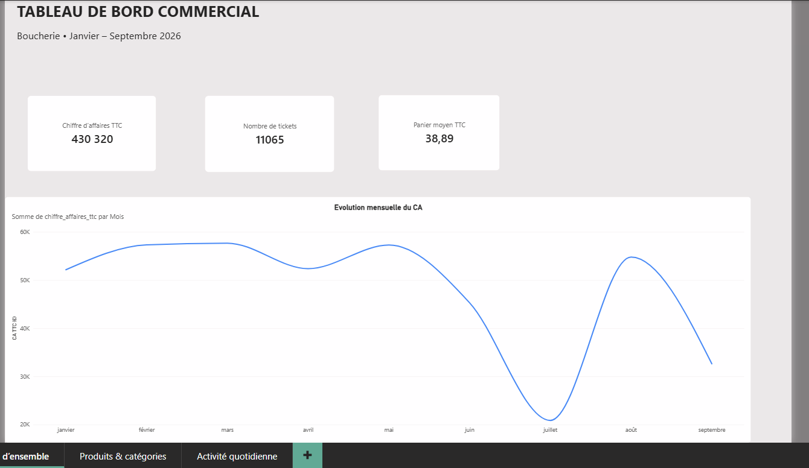
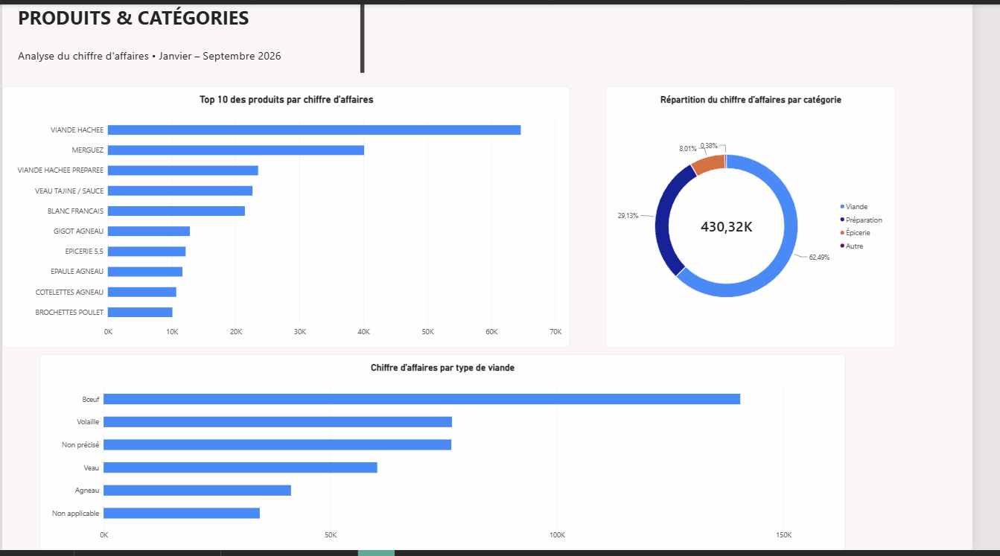
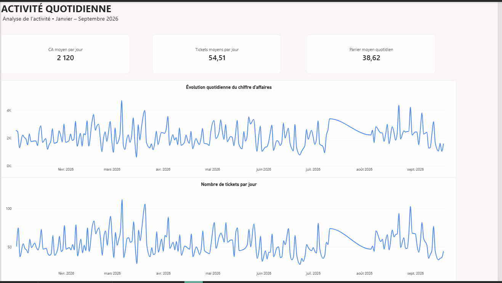

# Boucherie Zagora | Sales Analytics & Business Intelligence

**Mission client réelle — Pau, France | Projet porté et piloté par Tarek Ben Mohamed**

## Contexte et objectif

Conception d'une solution décisionnelle pour exploiter les exports du logiciel de caisse d'une boucherie : fiabiliser les ventes, automatiser les traitements et produire des indicateurs de pilotage exploitables dans Power BI.

## Architecture

`Excel (caisse) → Python (normalisation) → contrôles CSV → Databricks → dbt (staging, marts et tests) → Power BI (reporting)`

Le DAG Airflow `boucherie_pipeline` orchestre les cinq premières étapes techniques, **jusqu'à `dbt build`**. Le rafraîchissement du rapport Power BI n'est pas orchestré par ce DAG.

## Stack

Python · Pandas · Apache Airflow · Docker · Databricks · SQL · dbt · Power BI · DAX

## Périmètre et résultats documentés

Le rapport d'exécution Airflow décrit un traitement de **9 fichiers mensuels**, soit **11 065 tickets**, **35 774 lignes de vente** et **27 exports CSV**, avec zéro rejet lors du test documenté du 23 septembre 2026. Ces chiffres correspondent au test décrit, pas à une garantie de traitement en production continue.

Le projet comprend 3 modèles de staging et 8 modèles de marts dbt, ainsi que des tests de cohérence. Le tableau de bord Power BI comporte trois pages : vue d'ensemble, produits/catégories et activité quotidienne.

## Organisation du dépôt

- `dags/` : DAG Airflow d'orchestration
- `scripts/` : normalisation Excel, chargement Databricks, exécution dbt
- `models/staging/` et `models/marts/` : transformations SQL dbt
- `tests/` et `python_tests/` : contrôles SQL et Python
- `airflow/` et `docker-compose*.yaml` : environnement local
- `docs/` : architecture et précautions de publication
- `Rapport_*.md` : rapports techniques historiques (certaines sections documentent des versions antérieures du DAG)

## Rôle dans le projet

Projet initié, cadré et piloté par **Tarek Ben Mohamed**, qui a apporté le client et réalisé les composants Python/Airflow, Databricks et Power BI. Les transformations dbt ont été implémentées dans le cadre du travail d'équipe sous sa coordination.

## Exécution et limites

La reproduction complète nécessite un environnement Docker/Airflow, une connexion Databricks configurée dans Airflow et des exports de caisse autorisés. **Aucun identifiant ni donnée client n'est fourni dans cette version.** Voir `docs/SECURITY_AND_PUBLICATION.md` avant toute publication.

Le DAG actuel définit la chaîne complète jusqu'à dbt, mais les anciens rapports d'essais ne prouvent pas à eux seuls une exécution réussie de toutes les étapes en conditions de production.

## Dashboard Power BI

Le fichier PBIX client est conservé hors de ce dépôt public tant que ses données embarquées et ses connexions n'ont pas été vérifiées. Ajouter des captures anonymisées dans `docs/dashboard/` après validation.

## Dashboard Power BI

Le rapport Power BI comporte trois pages permettant d'analyser les performances commerciales de la boucherie sur la période janvier–septembre 2026.

### 1. Vue d'ensemble
Suivi du chiffre d'affaires, du nombre de tickets, du panier moyen et de l'évolution mensuelle.

### 2. Produits et catégories
Analyse des produits les plus performants, de la répartition du chiffre d'affaires par catégorie et des types de viande.

### 3. Activité quotidienne
Analyse des variations quotidiennes du chiffre d'affaires et du nombre de tickets. La période de fermeture de l'établissement est prise en compte dans l'interprétation des résultats.

